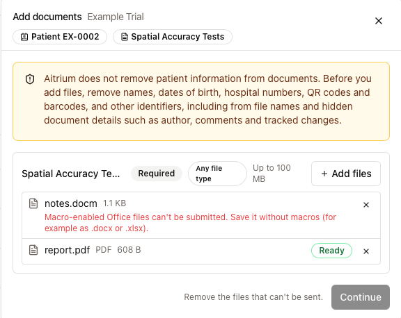
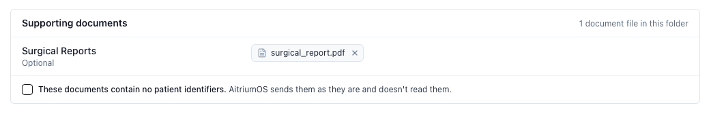

import { Audience } from '/snippets/audience.mdx';

<Audience who="Site users (EORTC and RTQA trials)" />

Documents reach a trial in one of two ways:

- **A documents-only submission**: a dataset type (EORTC trials) or an event (RTQA trials) that asks only for documents.
- **Supporting documents in an imaging submission**: documents sent with a patient's images (EORTC trials).

<Warning>
  AitriumOS doesn't check documents for patient information or remove it. It sends them exactly as you add them. Remove patient information before you add a file.
</Warning>

## Documents-only submissions

Start it the same way as any submission:

- **EORTC trials:** select **Submit Dataset** under the dataset type in the patient's row.
- **RTQA trials:** select **Submit** on the event in the **Patient Submission Queue**.

The flow has its own steps: **Add documents**, **Confirm**, **Review and submit**, **Submitted**. There's no analyzer, structure, de-identification, or QA step.

### Add files

The screen opens with this notice:

> Aitrium does not remove patient information from documents. Before you add files, remove names, dates of birth, hospital numbers, QR codes and barcodes, and other identifiers, including from file names and hidden document details such as author, comments and tracked changes.

Each document the trial asks for has its own card, with the formats it accepts (or **Any file type**) and a **Required** badge where it applies. Select **Add files** on a card to add files to it.

Each file shows **Ready**, or the reason it can't be sent, for example:

- "This looks like a DICOM file. Submit imaging through an imaging submission."
- "Programs and scripts can't be submitted."
- "Macro-enabled Office files can't be submitted. Save it without macros (for example as .docx or .xlsx)."
- "This format isn't accepted here. Accepted: …"
- "You already added this file." or "This file is empty."

Remove those files, then select **Continue**. Each required card needs at least one file.

### Confirm and send

1. Read the confirmation statement for this submission type and select its checkbox. If you change the files, select it again.
2. Select **Submit**.
3. Check the summary (**Submitting for**, **Trial**, **Destination**, **Files**), then select **Submit documents**.

When AitriumOS shows "Documents submitted.", the submission is recorded and the patient's row updates by itself. If the trial team has instructions, they appear under **Instructions from [organization]**.

### If a documents send is interrupted

AitriumOS never sends the same files twice.

- **Check delivery and continue**: an earlier attempt didn't finish. AitriumOS checks the destination first, then finishes the send.
- **Retry recording**: "Your files were delivered, but Aitrium couldn't record the submission yet." Retrying records it without sending the files again.
- "Document submission isn't available for this site's transfer method. Contact Aitrium support." Your site's upload method can't send documents yet. Contact [support@aitriumos.com](mailto:support@aitriumos.com).

## Supporting documents in an imaging submission

This applies to EORTC dataset types that name documents (for example a surgical report). Put the documents in the patient's folder with the images.

On the analyzer, **Supporting documents** lists each document the dataset type names, marked **Required** or **Optional**.

1. For each document, select **Choose a file** and pick the matching file from the folder. Use **Add another file** if one document spans several files.
2. Select the checkbox **These documents contain no patient identifiers.**

Files you don't choose aren't sent. A required document with no file reads "No file chosen. It's sent without it." Missing documents never stop the submission: the trial team sees what was sent.

## Related

- [EORTC data submission](/aitrium-os/no-protocol-submissions)
- [RTQA data submission](/aitrium-os/protocol-submissions)
- [Troubleshooting](/aitrium-os/submission-troubleshooting)
