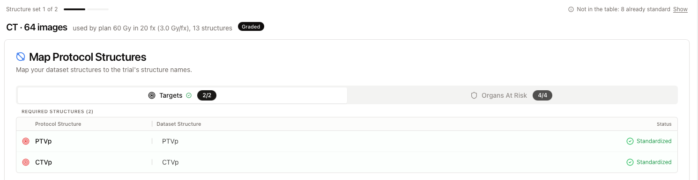

import { Audience } from '/snippets/audience.mdx';

<Audience who="Site users (EORTC and RTQA trials)" />

A folder can hold more than one structure set, for example one on the planning CT and one on an MR or a boost plan. AitriumOS sends all of them. It only asks you about the sets that have names to decide.

## One step per structure set

Each set that needs a decision gets its own step, for example "Structure set 1 of 2: CT · 142 images", with a line that says how it's used ("used by plan …", "used by 2 plans", or "not used by a plan").

- **Decide once.** A name you choose in one set is filled in for the same structure in later sets, with a note such as "Chosen in set 1". You can still change it in a later set. That changes it in that set only.
- **Nothing to decide.** A later set where every name was already decided reads "Nothing new here. Every name was decided in an earlier structure set."
- **Sets without a step.** Sets that already use the trial's names have no step. An imaging set that isn't standardized is listed under "Also sent, with the site's names". Both are still sent.

The last step says what its button saves, for example "Apply Changes saves both structure sets." Names only need to be unique within a set, so two sets can use the same name.

## In RTQA trials

- Step 1 is the set QA uses. It carries a **Graded** chip ("Quality checks run on this structure set.") and opens on **Map Protocol Structures**.
- Other sets say "The graded set covers the trial's requirements. Map structures here only where this set should use the protocol's names." Their targets are never renamed to the protocol's targets.
- When the required names are covered, AitriumOS says "All required names are covered across this patient's structure sets."

## Related

- [EORTC data submission: Standardize structure names](/aitrium-os/no-protocol-submissions#2-standardize-structure-names)
- [RTQA data submission: Map structures](/aitrium-os/protocol-submissions#2-map-structures)
