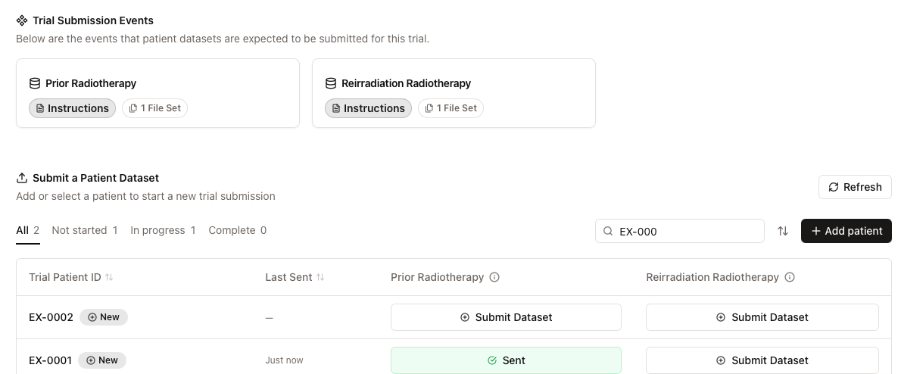
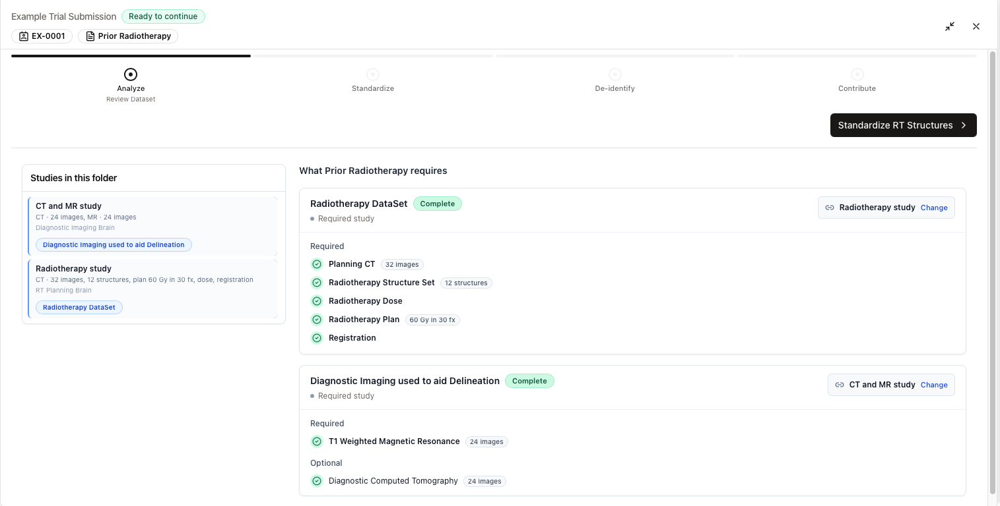
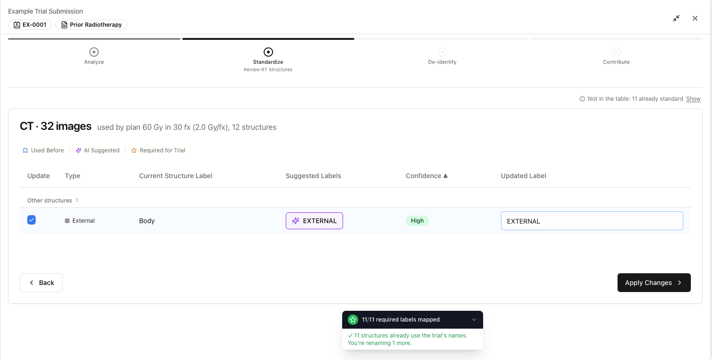
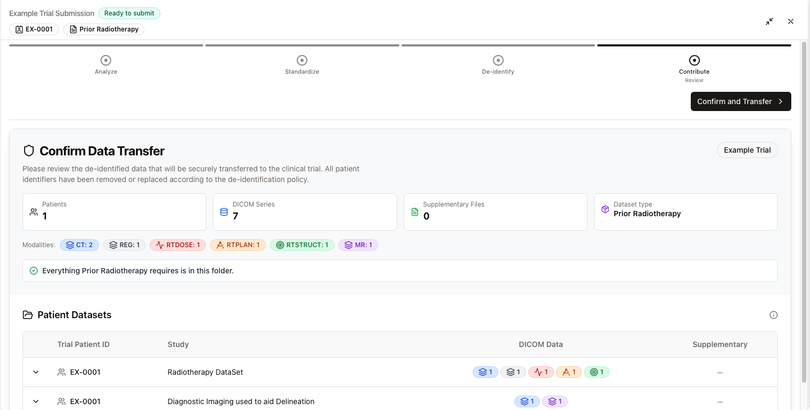
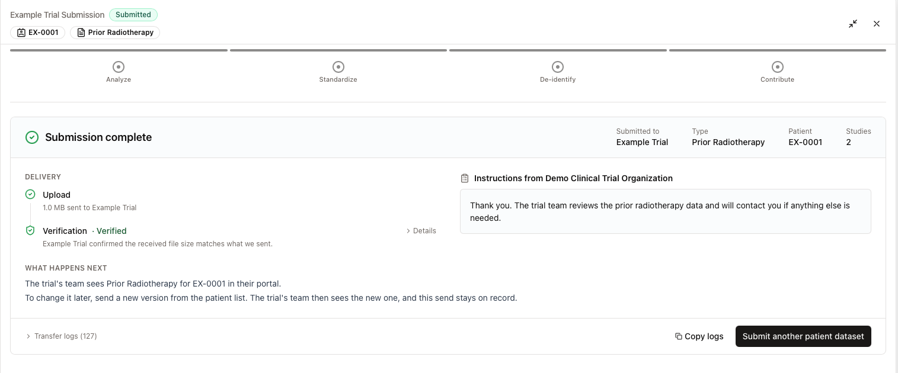
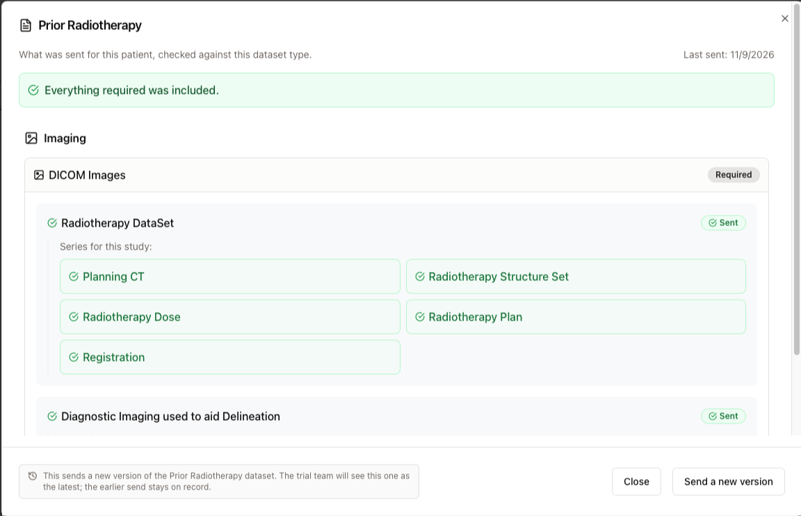

import { Audience } from '/snippets/audience.mdx';

<Audience who="Site users submitting to EORTC trials" />

<Info>
  **This guide is for EORTC trials.** If your trial page shows a **Trial Data Submission Schedule**, follow [RTQA data submission](/aitrium-os/protocol-submissions) instead. New in 2.3? See [What's new in AitriumOS 2.3](/aitrium-os/whats-new-2-3#if-you-submit-to-eortc-trials).
</Info>

Each EORTC trial lists its **dataset types** (for example a planning dataset or a prior radiotherapy dataset) under **Trial Submission Events** on the trial page. Select **Instructions** on a dataset type to read the trial team's instructions for it. You send one dataset type for one patient at a time, from a folder that holds that patient's export.

## Walkthrough

{/* EORTC WALKTHROUGH PLACEHOLDER: replace this embed with the 2.3.4 re-recording (script: docs/eortc-walkthrough-script.md) once it exists. Until then, today's walkthrough stays so nothing breaks. */}

  <iframe
    src="https://supercut.video/embed/aitrium/K8ppUTUdCx8K6rN6sc62GN?embed=full"
    style={{ position: "absolute", top: 0, left: 0, width: "100%", height: "100%", border: 0 }}
    allow="accelerometer; autoplay; clipboard-write; encrypted-media; gyroscope; picture-in-picture"
    allowFullScreen
  />

## Before you start

- Confirm your trial training (see [EORTC submission training](/training/basic-submission)).
- Export one patient's data for one dataset type into its own folder.
- Remove patient information from any documents you plan to send, including file names. AitriumOS doesn't check documents for patient information or remove it.

## Add a patient

1. Open the trial in AitriumOS. Patients are listed under **Submit a Patient Dataset**.
2. Type the patient's **Trial Patient ID** in **Search or add ID**, then select **Add patient**.
3. Check the ID in the dialog and select **Save**.

<Warning>
  Enter the Trial Patient ID exactly as the trial assigned it. Never enter a medical record number or other identifying value.
</Warning>

If the patient already exists, the list shows that patient. If the ID is close to an existing one, AitriumOS shows **Similar to existing patient** so you can check it first.

The list has one column per dataset type. Filter it with the status tabs (**All**, **Not started**, **In progress**, **Complete**), and select **Refresh** to load the latest.

## Start a submission

1. In the patient's row, select **Submit Dataset** under the dataset type you're sending.
2. Select **Select Directory** and choose the patient's folder.

AitriumOS first checks disk space and the connection, and continues by itself once any problem is fixed ([Getting ready](/aitrium-os/submission-troubleshooting#getting-ready)). A dataset type that holds only documents has its own short flow: see [Documents submissions](/aitrium-os/documents-submissions).

## Submission steps

The header shows the steps, **Analyze · Standardize · De-identify · Contribute**, and the step's state, for example **1 choice**.

### 1. Check the dataset

AitriumOS compares the folder with what the dataset type requires.

- **Studies in this folder** names each study by what it holds, for example "Radiotherapy study".
- **What [dataset type] requires** lists each required study, the folder study matched to it, and the items it needs, marked **Required** or **Optional**. A study with everything it needs reads **Complete**. To match a different study, select **Change**.
- A study that matches no requirement is still sent: "Not part of [dataset type]'s requirements · sent with it".
- A registration saved in another study counts for the study it references.
- If the folder holds more than one plan, AitriumOS asks "This folder holds N radiotherapy plans. Which one is the [dataset type]?". Choose **Use this plan** on the right one.
- **Supporting documents** appears when the dataset type names documents. See [Supporting documents](/aitrium-os/documents-submissions#supporting-documents-in-an-imaging-submission).

Missing items never stop you. If something is in another folder, close the submission and start again with that folder, or continue: the trial team sees what was missing.

Select **Standardize RT Structures** (or **Check De-Identification** if there's no structure set). In **Before you continue**, confirm that you'll check images for burned-in patient information and that any documents contain no patient identifiers. The button says what happens, for example **Continue without the missing items**. Nothing is sent until you confirm the transfer.

### 2. Standardize structure names

This step appears when the folder has a structure set. AitriumOS suggests the trial's structure name for each of your structures.

Structures that already use the trial's names aren't in the table. The line **Not in the table: N already standard** counts them. Select **Show** to see them.

1. Check the suggestions under **Suggested Labels**. Change any name under **Updated Label**.
2. In the **Update** column, select the structures to rename, then select **Apply Changes**. If you select none, the button reads **Continue with Standard Labels**.

If the folder has more than one structure set, you go through them one at a time. See [Multiple structure sets](/aitrium-os/multiple-structure-sets).

### 3. De-identify

AitriumOS de-identifies the DICOM metadata with the trial's de-identification policy, then checks the result. This runs by itself.

<Danger>
  AitriumOS de-identifies DICOM metadata only. It doesn't remove patient information burned into image pixels, and it doesn't remove patient information from documents. Check both before you send.
</Danger>

If the disk fills up or a step fails, AitriumOS asks what to do. See [Troubleshooting](/aitrium-os/submission-troubleshooting#de-identification).

### 4. Review

Under **Contribute**, **Confirm Data Transfer** shows the de-identified dataset: patients, DICOM series, supplementary files, the dataset type, and the modalities. One statement sums up what the dataset type requires, for example "Everything [dataset type] requires is in this folder." or "Missing for [dataset type]: …". **Patient Datasets** lists each study. Check it, then select **Confirm and Transfer**.

### 5. Upload to trial

The upload has two parts, shown on the transfer card:

1. **Data Transfer** sends the dataset to the trial's destination.
2. **Aitrium Sync** records the submission with Aitrium and notifies the trial team.

When both finish, **Submission complete** appears. **Delivery** shows the **Upload** and its **Verification**. **What happens next** tells you what the trial team sees. **Instructions from [organization]** shows the trial team's instructions for this dataset type, if there are any. Follow them each time. To send the next dataset, select **Submit another patient dataset**.

<Warning>
  **Keep AitriumOS open until Submission complete appears.** A progress bar at 100% isn't the end. If you close AitriumOS early, the trial team may get the files without a record of the submission.
</Warning>

## Check the submission

Back on the trial page, find the patient. The dataset type's cell reads **Sent** (or **Sent · N required items missing**), and **Last Sent** shows the time.

Select the cell to see "What was sent for this patient, checked against this dataset type.", with the date it was last sent and a summary such as "Everything required was included."

If the cell still reads **Submit Dataset**, or the row says **Last send didn't finish.**, see [Troubleshooting](/aitrium-os/submission-troubleshooting#interrupted-sends).

## Send a new version

To correct or complete a dataset, don't add the patient again.

1. Select the patient's **Sent** cell.
2. Select **Send a new version** and go through the same steps.

The trial team sees the new send as the latest. The earlier send stays on record.

## Need help?

- [Troubleshooting](/aitrium-os/submission-troubleshooting): disk space, connection, interrupted sends, and what to send to support.
- Contact [support@aitriumos.com](mailto:support@aitriumos.com) with your trial name and Trial Patient ID.
