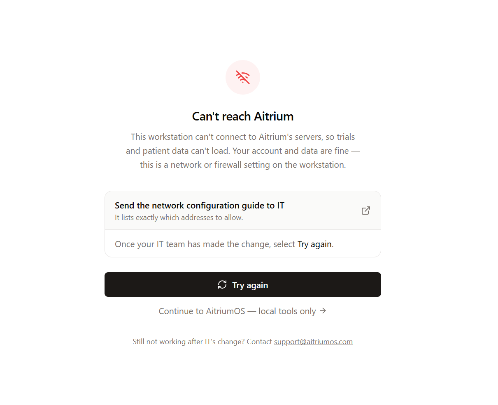
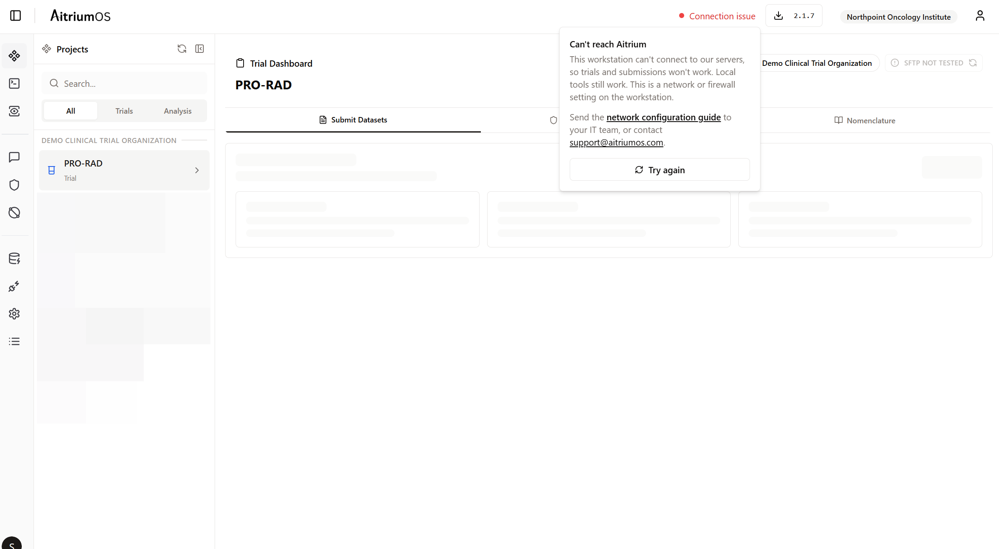
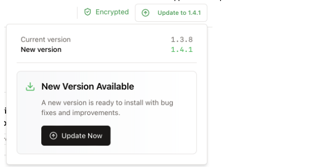

import { Audience } from '/snippets/audience.mdx';

<Audience who="Site users (with a checklist to forward to Site IT)" />

## Overview

Welcome to Aitrium. We developed AitriumOS to streamline trial participation for contributors by making it easier to standardize, validate, and upload data to investigators.

This page guides first-time users through setup and installation. Updating from 2.2? See [What's new in AitriumOS 2.3](/aitrium-os/whats-new-2-3).

### The Two Parts of Aitrium

You'll use Aitrium in two places, with one sign-in for both:

- **Aitrium Web** ([app.aitriumos.com](https://app.aitriumos.com)) — sign in from any browser to download AitriumOS, view your submissions, and manage users.
- **AitriumOS desktop app** — installed on your workstation; where you prepare and submit patient datasets. All submission work happens here.

### Before You Begin

There are two quick checks before installing AitriumOS — one you can do yourself, and one for your site's IT team.

**1. Check that you can sign in**

- You should have received an Aitrium account invitation for your site. If you have not, contact your trial coordinator.
- Verify you can sign in at [https://app.aitriumos.com](https://app.aitriumos.com). The desktop application uses this same sign-in.

**2. Forward the requirements below to your IT team**

Most hospital networks restrict which applications can be installed and which network connections are allowed. You do not need to understand or check these items yourself — send this page to your IT team and ask them to confirm each item for the computer you will use. The full IT guide is the [IT setup checklist](/aitrium-os/it-setup).

<Note>
  **For IT staff — requirements for AitriumOS (clinical trial data submission application):**

  - **Installation** — AitriumOS is a desktop application for Windows 10/11 (64-bit) or macOS on Apple silicon (Intel Macs aren't supported from 2.3). The user needs it installed on their workstation. The first launch of AitriumOS 2.3 upgrades its local database on the workstation one-way, so an earlier version can't be reinstalled over it.
  - **Disk space** — during a submission, the application creates a temporary de-identified working copy of the patient imaging dataset, so the workstation needs transient free space roughly equal to the dataset being submitted. Working copies are deleted automatically when the submission completes or is cancelled (leftovers from interrupted sessions are removed the next time the application starts), so storage utilization does not accumulate over time.
  - **Web access** — outbound HTTPS (port 443) from the workstation to `app.aitriumos.com` and Aitrium service endpoints.
  - **Data upload** — for trials that transfer data over SFTP, outbound SFTP/SSH (TCP, usually port 22) from the workstation directly to the trial's SFTP server. This connection **cannot go through a web (HTTP) proxy**, so outbound firewall rules must permit it. Allow the **program** `NewLeaf.exe` (`C:\Program Files\AitriumOS\` for the MSI installer, `%LOCALAPPDATA%\AitriumOS\` for the standard installer), not just the port. The host and port are listed in AitriumOS under **Settings → Network → Upload destinations**.
  - **Trial SFTP servers that restrict IP addresses** — the trial's server sees the site's **public egress IP address**. If the trial organization only accepts approved addresses, send them that address.

  Details: [IT setup checklist](/aitrium-os/it-setup) and [Upload connection troubleshooting](/aitrium-os/connection-troubleshooting).
</Note>

#### How you'll know: "Can't reach Aitrium"

You do not need to test the network requirements yourself — AitriumOS checks its own connection every time it runs. **If you can sign in and don't see either of the warnings below, the workstation's network is configured correctly and no IT involvement is needed.**

If the network does block Aitrium, the application tells you in two places:

- **Right after sign-in** — a full-screen message:

- **While signed in** — a red **Connection issue** indicator in the header; select it for details:

Both mean the same thing: the workstation cannot connect to Aitrium's servers (the **Web access** requirement above), so trials and submissions won't work until the connection is restored. **Your account and data are fine** — this is a network or firewall setting on the workstation, not a problem with Aitrium or your sign-in. Local tools remain available in the meantime.

To resolve it:

1. Use the in-app link to send the **network configuration guide** to your IT team — it lists exactly which addresses to allow (the same information as the [firewall allowlist](/security/aitrium-os/data-flows#firewall-allowlist)). If your site routes traffic through a corporate proxy, IT should also see [Corporate HTTP proxy](/security/aitrium-os/proxy-configuration).
2. Once IT has made the change, select **Try again**.
3. If the message persists after IT's change, contact [support@aitriumos.com](mailto:support@aitriumos.com).

<Info>
  Sign in on the workstation well before your first submission is due — not the day data is due — so any network change has time to be made. The **Data upload** (SFTP) connection is separate from this check. To test it, open **Settings → Network → Upload destinations** and select **Check now** next to your trial's server: a check confirms the server can be reached without signing in or sending data. If it doesn't show **Reachable**, see [Upload connection troubleshooting](/aitrium-os/connection-troubleshooting) for what the message means and who needs to act.
</Info>

### Installing AitriumOS

1. **Log in to Aitrium**: Access your account at [https://app.aitriumos.com](https://app.aitriumos.com) using your provided username and password.

2. **Download the Application**: 
   - Navigate to 'Downloads' on the lefthand navigation bar — open the page **on the computer you want to install AitriumOS on**, and it will recommend the right download for that computer
   - For **Windows**, there are two installers that do the same thing but install differently:
     - **Standard installer** — installs for your account only and does **not** need administrator rights. This is the right choice for almost everyone installing on their own workstation.
     - **MSI installer** — installs machine-wide for all accounts and **requires administrator rights**. Only choose this if your IT department deploys software this way (they will usually know).
   - For **Mac**: download the Apple silicon build. AitriumOS 2.3 isn't built for Intel Macs. To check your Mac, open the Apple menu → **About This Mac**: the **Chip** line names an Apple chip (for example Apple M1). If your Mac has an Intel processor, contact [support@aitriumos.com](mailto:support@aitriumos.com).

<Warning>
**Install only one Windows installer type.** Installing both puts two copies of AitriumOS on the computer, with the same icon, that can run different versions. If the MSI copy is already installed, the standard installer warns before it installs anything: "AitriumOS is already installed for everyone on this computer." Choose **No** and keep using that copy. If you're not sure what's installed, check **Windows Settings → Installed apps** first. The Downloads page also warns you if you're about to download a different type than you used before.
</Warning>

3. **Install the Application**: Follow your operating system's standard installation process.

#### Switching Windows installer types

If you want to move from one Windows installer type to the other — for example, switching to the Standard installer so future updates never need an administrator — switch cleanly rather than installing the second type alongside the first:

1. **Check what is installed now**: open **Windows Settings → Installed apps** and search for AitriumOS. If more than one AitriumOS entry is listed, you already have duplicate copies — remove all of them in the steps below, then install fresh.
2. **Uninstall the existing copy**:
   - An **MSI copy** was installed machine-wide, so removing it **requires administrator rights one last time** — if you don't have them, ask IT to uninstall it. After that, the Standard installer installs and updates without ever needing an administrator again.
   - A **Standard copy** uninstalls without administrator rights.
3. **Install the new type**: return to the Downloads page and download the type you want. (The page will show a warning because your previous downloads were the other type — that warning exists to prevent *accidental* switches; when you're switching on purpose, continue.)
4. **Your data is safe either way**: submitted trial data lives in Aitrium, not on the workstation, and your local sign-in and settings are kept through an uninstall/reinstall.

### Using AitriumOS

After installation, launch AitriumOS and sign in. The sign-in screen shows the version you're running. Then follow the guide for your trial: [EORTC data submission](/aitrium-os/no-protocol-submissions) or [RTQA data submission](/aitrium-os/protocol-submissions). If you see a **"Can't reach Aitrium"** message instead of your trials, the workstation's network is blocking the connection — see [the section above](#how-you’ll-know-“can’t-reach-aitrium”).

### App Updates
If an update is available for AitriumOS, you will see the version button in the header turn blue:

To install the update:
- Click "Update Now" to start downloading the version
- Once the download succeeds, the application will automatically close to apply the update 
- After the update completes, the application will re-open.

## Need Help?

If you run into problems during set-up:
- Contact support at [support@aitriumos.com](mailto:support@aitriumos.com)
- Include your operating system version and, for connection issues, the error message shown in the app