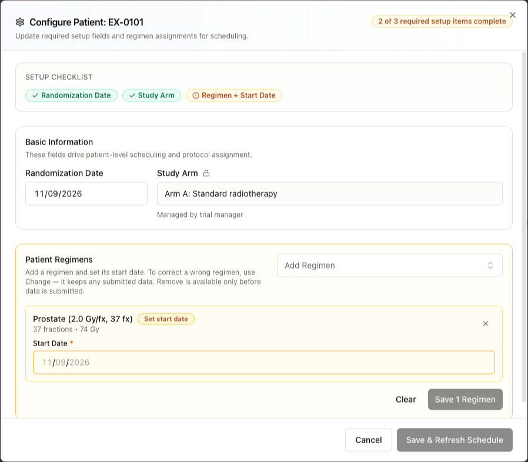
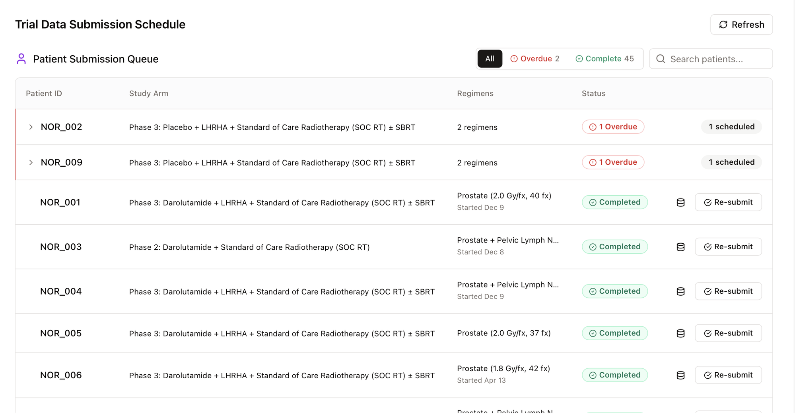
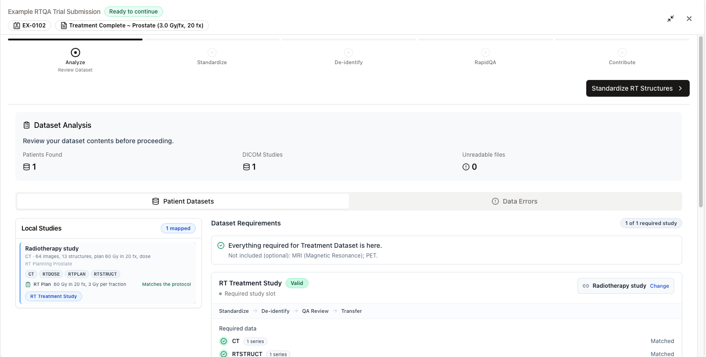
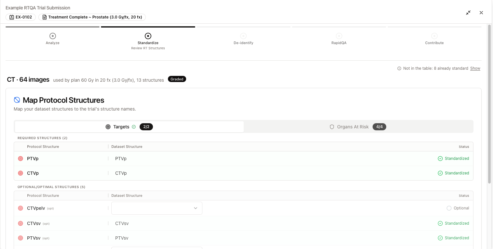
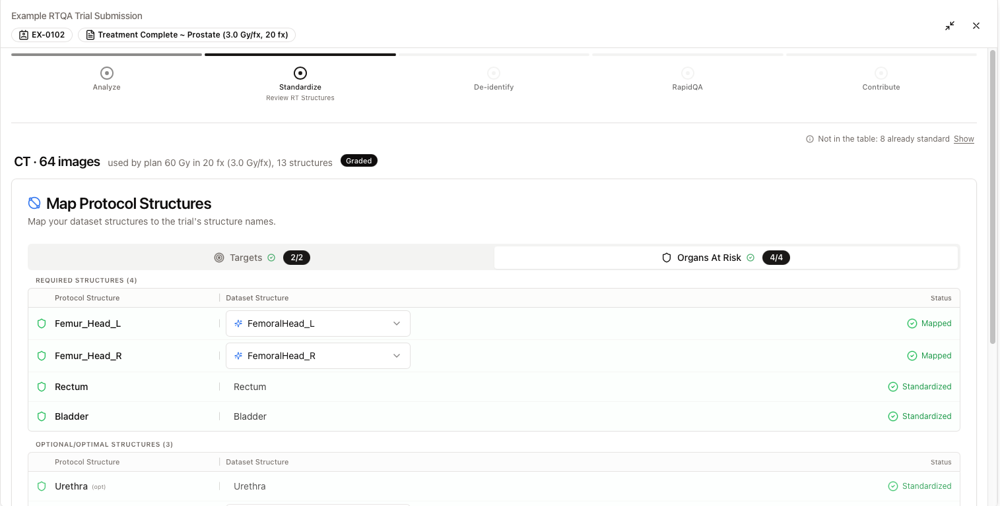
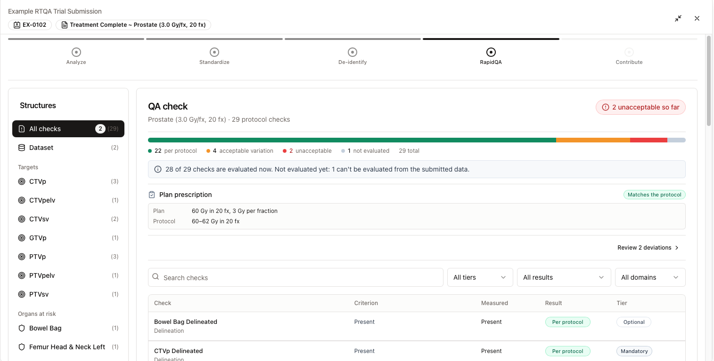
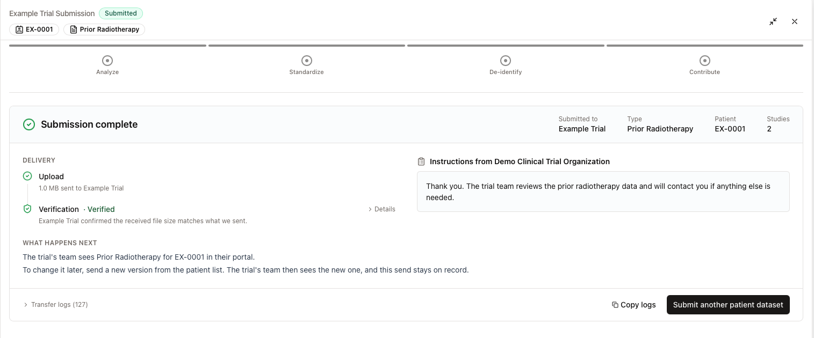
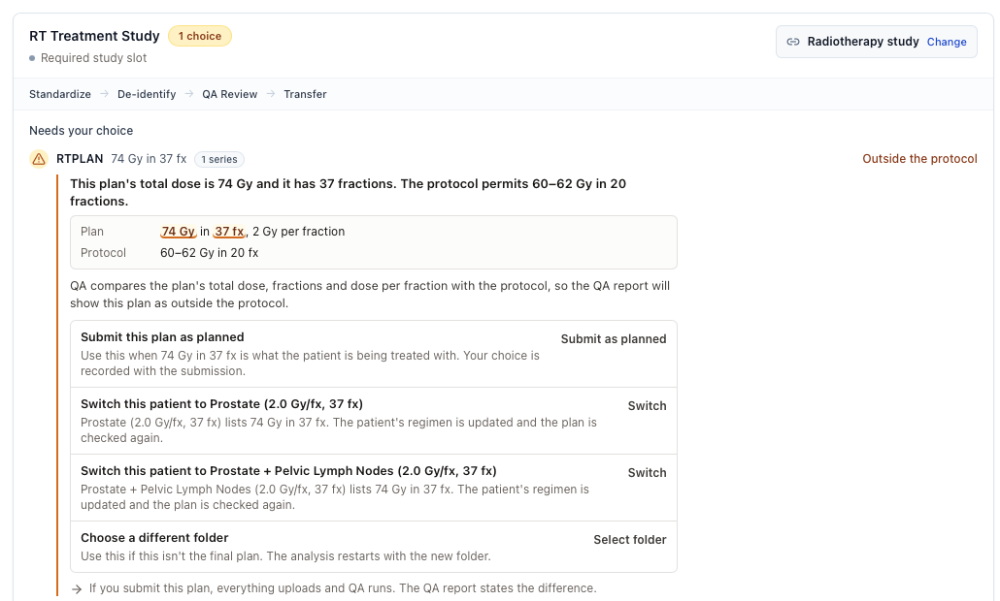

import { Audience } from '/snippets/audience.mdx';

<Audience who="Site users submitting to RTQA (protocol) trials" />

<Info>
  **This guide is for trials whose page shows a Trial Data Submission Schedule.** Submitting to an EORTC trial? Follow [EORTC data submission](/aitrium-os/no-protocol-submissions) instead. New in 2.3? See [What's new in AitriumOS 2.3](/aitrium-os/whats-new-2-3#if-your-trial-uses-rtqa-protocol-trials).
</Info>

RTQA trials come set up with study arms, regimens, a schedule, and QA checks. You set up each patient's regimen once, then submit each event as it falls due.

## Before you start

- Confirm your trial training (see [RTQA submission training](/training/rtqa-submission)).
- Export one patient's data for one event into its own folder: images, structure set, plan, and dose.
- Remove patient information from any documents you plan to send, including file names. AitriumOS doesn't check documents for patient information or remove it.

## Set up a patient

Each patient in the **Patient Submission Queue** needs a study arm and a regimen before their submissions are scheduled.

1. Select **Setup Patient** in the patient's row (or **Configure Regimens** on one of their events). **Configure Patient** opens, with a badge such as "2 of 3 required setup items complete". The **Setup Checklist** shows which items are done.
2. Under **Basic Information**, set the **Randomization Date** and **Study Arm**, then select **Save & Refresh Schedule**. If the trial doesn't require the date, it's marked **(optional)**.
3. Under **Patient Regimens**, choose a regimen in **Add Regimen**, set its **Start Date**, then select **Save 1 Regimen**. You can add more than one.

Fields marked **Managed by trial manager** are set by the trial team. To correct a wrong regimen, use **Change**. It keeps any submitted data. **Remove** is available only before data is submitted.

## Find due submissions

The **Patient Submission Queue** lists site-level submissions first, then each patient's events with their due date and status (for example **Scheduled**, **Overdue**, **Pending Dates**, or **Completed**). Filter by status, and select **Refresh** to load the latest. Select **Submit** on an event to start.

An event that asks only for documents has its own short flow. See [Documents submissions](/aitrium-os/documents-submissions).

## Submission steps

Select **Select Directory** and choose the patient's folder. AitriumOS first checks disk space and the connection, and continues by itself once any problem is fixed ([Getting ready](/aitrium-os/submission-troubleshooting#getting-ready)).

The header shows the steps, **Analyze · Standardize · De-identify · RapidQA · Contribute** (RapidQA only when the trial has QA checks), and the step's state, for example **1 choice**.

### 1. Check the dataset

AitriumOS compares the folder with what the event requires. **Dataset Analysis** counts the patients, DICOM studies, and unreadable files in the folder. On **Patient Datasets**:

- **Local Studies** names each study by what it contains, for example "Radiotherapy study", and shows the plan check, for example **Matches the protocol**.
- **Dataset Requirements** sums it up, for example "Everything required for Treatment Dataset is here.", and shows whether each required item is **Matched**. To match a different study, select **Change**.

Anything that needs attention is grouped as:

- **Missing**: required items not in the folder.
- **Needs your choice**: questions about data that is there.

A registration saved in another study counts for the study it references ("In another study").

While the plan and dose are checked, the button reads **Checking plan and dose…**. Then review the plan and dose rows ([Plan and dose checks](#plan-and-dose-checks)).

Missing items never stop you. To continue, select the button at the top, for example **Standardize RT Structures**. **Review Before Proceeding** opens, with two pages:

1. **Review**: check what you're about to send.
2. **De-identification**: select the checkbox to confirm that you'll check images for burned-in patient information and that any documents contain no patient identifiers, then select **Proceed**.

### 2. Map structures

This step appears when the folder has a structure set. AitriumOS first gets name suggestions. If that takes more than a minute, select **Map structures myself** or **Try again**.

On **Map Protocol Structures**, map your dataset structures to the trial's structure names. Targets and organs at risk are on separate tabs, **Targets** and **Organs At Risk**, each with a count such as **2/2**. Each tab lists required structures first, then optional ones.

- For each **Protocol Structure**, choose your structure under **Dataset Structure**. AitriumOS suggests one where it can.
- Rows that already use the trial's name read **Standardized** and need no mapping. Rows you map read **Mapped**. An optional structure left empty reads **Optional**.
- A required PRV without a margin, such as Brainstem_PRV, is met by your PRV with any margin, such as Brainstem_PRV03.

If a required structure isn't mapped, **Required structures not mapped** lists it. Choose **Go back and map** or **Continue without mapping**. Unmapped structures are sent with your names.

If the folder has more than one structure set, see [Multiple structure sets](/aitrium-os/multiple-structure-sets).

### 3. De-identify

AitriumOS de-identifies the DICOM metadata with the trial's de-identification policy, then checks the result. This runs by itself.

<Danger>
  AitriumOS de-identifies DICOM metadata only. It doesn't remove patient information burned into image pixels, and it doesn't remove patient information from documents. Check both before you send.
</Danger>

If the disk fills up or a step fails, AitriumOS asks what to do. See [Troubleshooting](/aitrium-os/submission-troubleshooting#de-identification).

### 4. QA check

This step appears when the trial has QA checks (**RapidQA** in the header). **QA check** shows Aitrium's preview of the trial's checks for this patient, for example "[regimen] · 29 protocol checks", graded **Per protocol**, **Acceptable variation**, **Unacceptable**, **Not evaluated**, or **Assessed after submission**. A bar counts the results, and **Plan prescription** compares the plan with the protocol.

- Use the **Structures** list, the filters (**Search checks**, **All tiers**, **All results**, **All domains**), **Show all N checks**, or **Review N deviations** to look through them.
- Checks the trial's QA team assesses after submission need nothing from you.
- If the preview is loading or unavailable, you can still continue. Grades are then computed after submission.

Select **Continue**. A result outside the protocol never stops you from sending.

If **QA checks didn't load** appears, check the connection, then select **Retry**.

### 5. Data transfer

**Confirm Data Transfer** shows the de-identified dataset: patient, event, and series by modality. If QA found results outside the protocol, it says so: "They appear in the QA report after you send." Check it, then select **Confirm and Transfer**.

The upload has two parts, shown on the transfer card:

1. **Data Transfer** sends the dataset to the trial's destination.
2. **Aitrium Sync** records the submission with Aitrium and notifies the trial team.

{/* screenshot pending: upload-in-progress.png */}

When both finish, **Submission complete** appears. **Delivery** shows the **Upload** and its **Verification**. **What happens next** tells you what the trial team sees. **Instructions from [organization]** shows the trial team's instructions, if there are any. Follow them each time.

<Warning>
  **Keep AitriumOS open until Submission complete appears.** A progress bar at 100% isn't the end. If you close AitriumOS early, the trial team may get the files without a record of the submission.
</Warning>

## Plan and dose checks

On the analyzer, AitriumOS compares the plan with the patient's regimen. Everything in the folder uploads whatever the result. Your choices are recorded with the submission.

| Plan status | What it means |
|---|---|
| **Matches the protocol** | The plan's dose and fractions match the regimen. |
| **Outside the protocol** | The plan differs from the regimen. AitriumOS asks one question (below). |
| **Not a listed schedule** | The plan is within the protocol range but isn't one of its listed schedules. Nothing to do. |
| **Review required** or **Checked after submission** | A course of more than one plan. The trial's QA team confirms it after submission. You don't need to do anything. |
| **No plan check** | No protocol plan check applies to this submission. |
| **Plan check unavailable** | The check isn't available right now. It runs again before you submit. |

**When the plan is outside the protocol**, the plan row moves under **Needs your choice**, the header reads **1 choice**, and AitriumOS shows the plan next to what the protocol permits. Choose one:

- **Submit this plan as planned** (**Submit as planned**): use this when the plan is what the patient is being treated with. Everything uploads, QA runs, and the QA report states the difference.
- **Switch this patient to [regimen]** (**Switch**): offered for each other regimen of the arm that lists this plan's schedule. The patient's regimen is updated and the plan is checked again.
- **Choose a different folder** (**Select folder**): use this if this isn't the final plan. The analysis restarts with the new folder.

**When there's more than one dose file**, AitriumOS picks a plan sum that covers every plan by itself. Otherwise it asks you to **Choose dose file**, with options named by plan. The dose you choose decides what QA evaluates: the whole course, or one plan. Select **Use this dose**.

**When the dose isn't the plan's full dose**, choose **Choose a new export** or **Submit without dose checks**. Without dose checks, those checks read **Not evaluated**.

## Check the submission

In the **Patient Submission Queue**, the event should read **Completed**. If it doesn't, or the row says "Last send didn't finish. You can send it again.", see [Troubleshooting](/aitrium-os/submission-troubleshooting#interrupted-sends).

## Re-submit

To correct or complete a submission, select **Re-submit** on the completed event and go through the same steps. The trial team sees the new send as the latest. The earlier send stays on record.

## Need help?

- [Troubleshooting](/aitrium-os/submission-troubleshooting): disk space, connection, interrupted sends, and what to send to support.
- Contact [support@aitriumos.com](mailto:support@aitriumos.com) with your trial name and Trial Patient ID.
