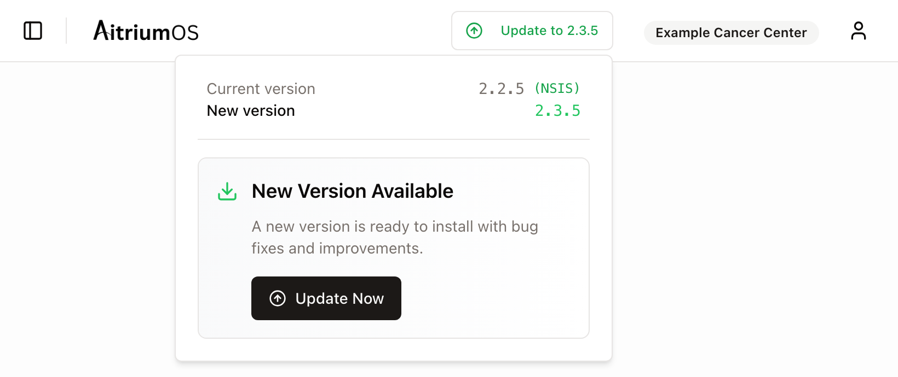
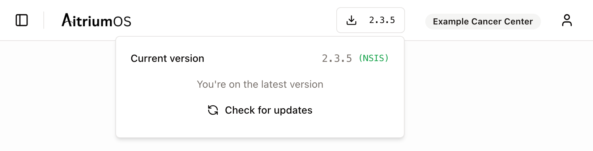

import { Audience } from '/snippets/audience.mdx';

<Audience who="Site users (with a section to forward to Site IT)" />

AitriumOS updates itself from inside the app. You don't need to download anything: the update downloads, installs and reopens AitriumOS for you. AitriumOS only offers updates. It never installs one until you start it.

## When to update

Update when either of these happens:

- **The header shows "Update to" and a version number**, for example **Update to 2.3.5**. AitriumOS checks for updates when you sign in and every hour while it is open.
- **AitriumOS or your trial team tells you your version is too old** for a trial's upload destination. For example, an upload can fail with *The SFTP server's security settings aren't supported by this version of AitriumOS. Please update AitriumOS or contact Aitrium support.* See [Upload connection troubleshooting](/aitrium-os/connection-troubleshooting#what-the-messages-mean).

## How to update

<Steps>
  <Step title="Finish what you're doing">
    Let any submission in progress finish first. AitriumOS closes while the update installs.
  </Step>
  <Step title="Select Update to …">
    Select **Update to** and the version number in the header, at the top right of the window. A panel shows your **Current version** and the **New version**.
  </Step>
  <Step title="Select Update Now">
    The button shows **Downloading…** while the update downloads. This can take a few minutes.
  </Step>
  <Step title="Let AitriumOS restart">
    AitriumOS closes, installs the update and reopens by itself. On Windows, a small installer progress window appears for a moment. Sign in again if asked.
  </Step>
</Steps>

Your sign-in, settings and submitted data are kept. Every update is cryptographically signed and checked before it is installed.

<Note>
  If AitriumOS shows *Please restart the application manually to complete the update*, close AitriumOS and open it again.
</Note>

## Check your version

Your version is shown in the header:

- **When you're up to date**, the header shows the version number, for example **2.3.5**. Select it to see **Current version** and **You're on the latest version**.
- **When an update is available**, the header shows **Update to** and the new version. Select it to see your **Current version**.

To check right away, select the version number and then **Check for updates**.

On Windows, the label next to the version shows how AitriumOS was installed: **(NSIS)** is the Standard installer, which installs for your account only. **(MSI)** is the MSI installer, which installs for the whole computer.

## If the update needs administrator rights or stops

This usually means AitriumOS was installed for the whole computer with the **MSI installer**, often by your IT team. Updating an MSI install needs administrator rights, so Windows may ask for an administrator's permission. If you can't give it, the update stops and your current version stays installed. Open AitriumOS again from the Start menu to keep working.

To update an MSI install, ask your IT team to:

1. Sign in at [app.aitriumos.com](https://app.aitriumos.com) and open **Downloads**.
2. Download the latest **MSI installer** and install it on your computer. It replaces the current version, and your settings are kept.

If you'd rather not need an administrator for future updates, IT can switch the computer to the Standard installer instead. See [Switching Windows installer types](/aitrium-os/overview#switching-windows-installer-types). Install only one type, because two installed copies can run different versions.

## On macOS

The steps are the same: select **Update to**, then **Update Now**, and AitriumOS reopens on the new version.

If AitriumOS shows **Update failed**, your Mac account may not be allowed to change the copy of AitriumOS in **Applications**, for example because another account installed it. Ask someone with administrator rights on the Mac to download the latest version for your processor (Apple Silicon or Intel) from [app.aitriumos.com](https://app.aitriumos.com) → **Downloads** and install it over the existing copy.

## Other problems

<AccordionGroup>
  <Accordion title="I was told to update, but the header doesn't show “Update to”">
    Select the version number in the header, then **Check for updates**. If it then shows **You're on the latest version**, no update is needed. Check that the version shown matches what you were told.
  </Accordion>
  <Accordion title="“Couldn’t check for updates” or “Updates unavailable”">
    AitriumOS couldn't reach its update server. Your submissions are not affected. Ask your IT team to allow `storage.googleapis.com` (see the [firewall allowlist](/security/aitrium-os/data-flows#firewall-allowlist)), then select **Check for updates**. Until then, IT can install the latest version from **Downloads** at [app.aitriumos.com](https://app.aitriumos.com).
  </Accordion>
  <Accordion title="“Update failed”">
    The update couldn't be downloaded or installed, and your current version is still installed. Try again later. If it fails again, contact support with the full message.
  </Accordion>
  <Accordion title="AitriumOS still shows the old version after updating, or there are two AitriumOS icons">
    The computer probably has two copies of AitriumOS, one from each Windows installer type, and the icon you opened is the copy that wasn't updated. Check **Windows Settings → Installed apps** for more than one AitriumOS entry and follow [Switching Windows installer types](/aitrium-os/overview#switching-windows-installer-types) to keep only one.
  </Accordion>
</AccordionGroup>

## Need help?

Contact [support@aitriumos.com](mailto:support@aitriumos.com) with your AitriumOS version, your operating system and the exact message shown in the app.
